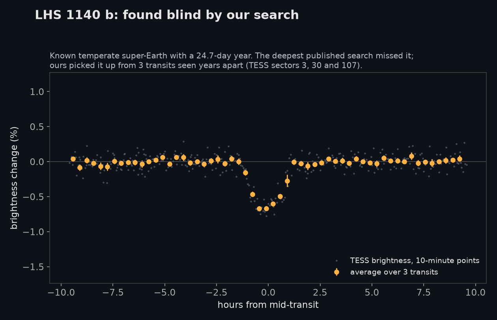
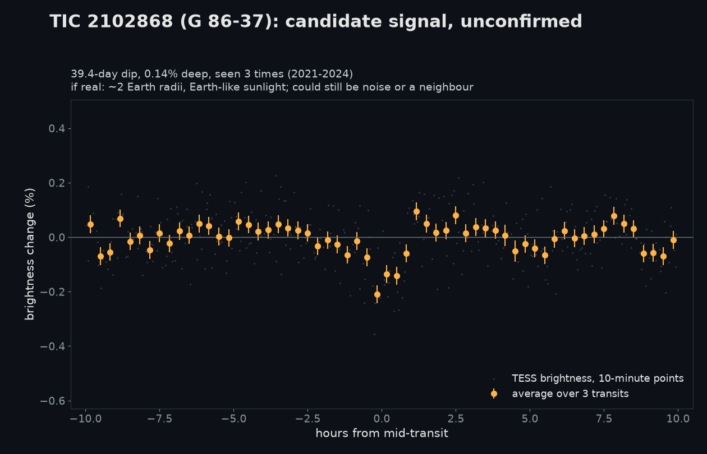

# Results so far (November 2026)

A plain-English account of what this project has searched, what it found, and how far to trust it.
The detailed records are linked at the end of each section.

## Summary

- **Planet search (Track C):** we searched 4,350 nearby red dwarfs for temperate, small planets with
  10-60 day orbits and found **no new planets**. Thirteen signals survived vetting; noise alone was
  expected to leave about 26. The search re-found every known planet in its range that it should have.
- **Weird-star hunt (Track A):** 150 of the most anomalous stars in six TESS sectors were vetted one by one.
  **None is unexplained.** By-products: one known disk star with unreported deep dimming, three pulsating-star
  candidates and about 30 eclipsing binaries with no catalogued period.
- Both results are nulls with measured sensitivity, which is what makes them worth writing down.

## Track C: temperate planets around nearby red dwarfs

### The idea
A temperate planet around a small red star has a year of roughly 15-50 days. NASA's TESS telescope watches
most stars for 27 days at a time and comes back months or years later, so such a planet shows only one transit
per visit. To see it, the visits have to be stitched together.

The deepest published search of this kind (Gillis, Cloutier & Pass, arXiv:2602.23364; 8,134 red dwarfs) joined
at most four back-to-back visits. As a result 57% of its stars were searched only to 14-day periods, it
recovered 6.5% of injected 1.0-1.5 Earth-radius planets at 15-30 days, and it missed the known temperate planet
LHS 1140 b. We join every visit a star has ever had, however far apart.

### The method
1. Take every TESS light curve of the star (SPOC 2-minute and TESS-SPOC full-frame products), binned to 10 minutes.
2. Remove slow trends and the star's own rotation signal.
3. Fold the result at about a million trial periods between 10 and 60 days and look for a repeating box-shaped dip.
4. Keep signals above a threshold set from scrambled ("null") copies of real light curves.
5. Vet each signal with a fixed set of tests, then check the pixels and the catalogues.

Every threshold was fixed before the data it was judged on were looked at, and each stage had a pass/fail
gate written down in advance.

### How it was tested
| Test | Result |
|---|---|
| Known planets, blind (gate 1) | LHS 1140 b and TOI-700 d recovered; Gliese 12 b just under threshold |
| Fresh known planets, blind (gate 2) | 28 of 31 recovered |
| Injected 1.0-1.5 Earth-radius planets, 15-30 d, test stars with 6+ visits | 54% recovered (95% range 47-61%) |
| Same, on the actual survey stars | about 18-19%, because most have fewer visits than predicted |
| Vetting v2: detected injected planets kept | 95% |
| Vetting v2: scrambled false alarms rejected | 52% of the weaker ones; no better than v1 at the detection threshold |

*A known temperate super-Earth, found by the search without being told it was there. The published search
of this kind missed it.*

### The survey
- **Targets:** 4,681 red dwarfs (2,700-3,400 K) within 50 parsecs, brighter than TESS magnitude 15.
- **Searched:** 4,350. The other 331 have no light curve in the products we used.
- **Data per star:** a median of 6 TESS visits; 45% of stars have fewer than 6.
- **Compute:** 90 CPU-hours across ten free Kaggle notebooks.

### The result
510 signals on 252 stars crossed the detection threshold.

| Outcome after vetting | Signals |
|---|---|
| Already-known planets and candidates | 48 |
| Rejected | 449 |
| Not rejected | 13 (3 in the top tier, 10 in the second) |
| Expected from noise alone | about 26 (95% range 2-83) |

Thirteen survivors against 26 expected means the survey shows no excess over noise, overall or in any period
or transit-count bin. Every survivor is more likely a false alarm than a planet, and none has been submitted
as a planet candidate.

Every known transiting planet at 10-60 days that the search should have caught was recovered blind:
TOI-6002 b, TOI-1452 b, TOI-406 c, TOI-1224 c, TOI-715 b, and the brown dwarf TOI-6508 b.

### The best leftover signal

**TIC 2102868 (G 86-37):** a 0.14% dip seen three times, 39.4 days apart. If real, it would be about twice
Earth's size with roughly Earth's sunlight. It probably is not real: Gaia flags the star as a possible binary,
and the pixel data hint that the dip comes from a neighbouring star. Free tests: the predicted dips on
2026-11-22, 2027-01-01 and 2027-02-09, and Gaia's fourth data release in December 2026.

### What limits it
- **Too few visits per star.** Sensitivity climbs steeply with the number of TESS visits: about 3% of injected
  planets are found on stars with 1-3 visits, 20% with 6-12, and 58% with 13 or more.
- **False alarms look like the target.** A few dips of ordinary noise, 40-55 days apart, are hard to tell from
  a real long-period planet using the light curve alone.
- **Light-curve products.** We used only two products and got 78% of the visits predicted from the telescope's
  pointing history.

Details: [`spikes/mdwarf_stack.md`](spikes/mdwarf_stack.md) (method, gates, survey),
[`spikes/mdwarf_vetting.md`](spikes/mdwarf_vetting.md) (vetting), [`shortlist_planets_v1.md`](shortlist_planets_v1.md)
(every surviving signal, with a paragraph each).

## Track A: the weirdest stars in TESS (parked)

- **Data:** six TESS sectors (32, 33, 38, 43, 44, 55), about 940,000 light curves.
- **Scoring:** a classical dip detector, a small self-supervised neural network, an ensemble of the two, a
  per-event veto for instrument artefacts, and tests for eclipsing binaries.
- **Gate:** not passed. The best scorer recovered 33% of injected 0.3%-deep events (the bar was 50%), and the
  ensemble ranked 5 of 18 known unusual stars in its top 1% (the classical detector ranked 11).
- **Vetting:** the 150 top uncatalogued candidates each got a light-curve card, a pixel-level check and a
  catalogue dossier.

| Class | Stars |
|---|---|
| Eclipsing binary | 56 |
| Scattered light and other instrument artefacts | 24 |
| Rotation / starspots | 16 |
| Pulsator | 13 |
| Asteroid crossing | 11 |
| Blend from a neighbouring star | 10 |
| Other ordinary variables (supergiants, flare stars, dwarf novae, a Be star) | 15 |
| Quiet, no real signal | 3 |
| Known young stars | 2 |
| **Unexplained** | **0** |

Worth a second look: **TIC 435923212** (IRAS 04193+1518), a known disk-bearing young star that dims
irregularly by 10-30%, which none of its SIMBAD references reports; three candidate high-amplitude γ Doradus
pulsators (TIC 411991552, 19701483, 307568749); and about 30 eclipsing binaries without a catalogued period.

A side finding: the SkyBoT asteroid service's TESS observer code returns Earth-centred positions. Correcting
for TESS's position raised the share of candidates explained by known asteroids from 24 to 83 of 572.

Details: [`PLAN.md`](PLAN.md) (results log), [`shortlist_candidates_v1.md`](shortlist_candidates_v1.md),
[`VETTING.md`](VETTING.md), [`ML_DESIGN.md`](ML_DESIGN.md).

## What is not claimed
- No planet, planet candidate or new class of star is claimed anywhere in this repository.
- Recovering known planets shows the method works; it is not a discovery.
- The novelty of the stacked search rests on a literature check made in November 2026 against paper abstracts
  and one paper read in full. An unpublished or missed search may exist.
